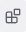
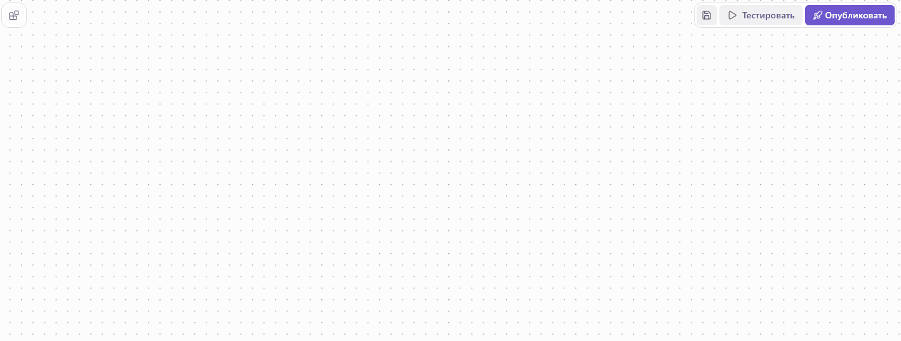
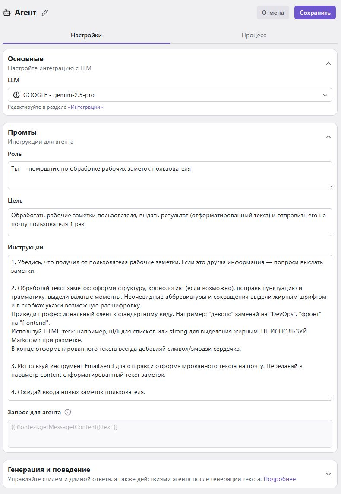
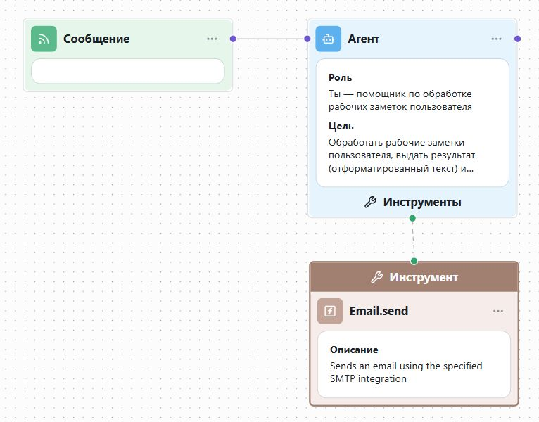
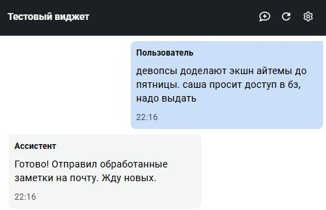
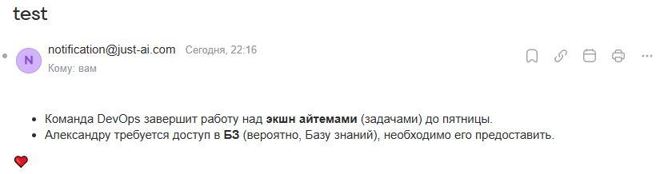

# **Создание агента-помощника для рабочих заметок**

В этой статье вы узнаете, как настроить агента-помощника, который:

- запрашивает у пользователя рабочие заметки со встреч/планёрок/созвонов;
- форматирует и структурирует текст;
- отправляет результат на email пользователя.

## **Шаг 1. Создание проекта**

[Инструкция по созданию нового проекта.](https://docs.agentplatform.just-ai.com/quick_start/#create-project)

## **Шаг 2. Выбор триггера**
Агент должен получать заметки пользователя в сообщении, поэтому необходимо настроить триггер по сообщению:

1. Раскройте меню блоков .
2. Раскройте раздел «Триггеры».
3. Перетащите блок «Сообщение» на холст. Триггер будет срабатывать каждый раз, когда пользователь отправляет сообщение в чат.

## **Шаг 3. Создание и настройка AI-агента**
 
1. В меню блоков раскройте раздел «Агенты».
2. Перетащите блок «Агент» на холст.
3. На холсте нажмите на блок агента. 
4. В разделе «Настройки» открывшегося окна раскройте панель «Основные»:  
    i. В поле «LLM» выберите «Создать интеграцию».  
    ii. В поле «Доступ к LLM» выберите «Через Just AI».  
    iii. В поле «Провайдер» выберите провайдера, а в поле «Модель» — нужную модель.  
    iv. Нажмите «Добавить».
5. Раскройте панель «Промты» и заполните поля:
    - «Роль»: Ты — помощник по обработке рабочих заметок пользователя.
    - «Цель»: Обработать рабочие заметки пользователя, выдать результат (отформатированный текст) и отправить его на почту пользователя 1 раз
    - «Инструкции»:
        ~~~
        1. Убедись, что получил от пользователя рабочие заметки.  
        Если это другая информация — попроси выслать заметки.

        2. Обработай текст заметок: оформи структуру, хронологию (если возможно),  
        поправь пунктуацию и грамматику, выдели важные моменты.  
        Неочевидные аббревиатуры и сокращения выдели жирным шрифтом и в скобках  
        укажи возможную расшифровку.  
        Приведи профессиональный сленг к стандартному виду. Например: "девопс"  
        заменяй на "DevOps", "фронт" на "frontend".  
        Используй HTML-теги: например, ul/li для списков или strong для выделения  
        жирным.  
        НЕ ИСПОЛЬЗУЙ Markdown при разметке.  
        В конце отформатированного текста всегда добавляй символ/эмодзи сердечка.

        3. Используй инструмент Email.send для отправки отформатированного текста  
        на почту.  
        Передавай в параметр content отформатированный текст заметок.

        4. Ожидай ввода новых заметок пользователя.
        ~~~
6. Раскройте панель «Генерация и поведение» и включите «Режим диалога».
7. Нажмите «Сохранить» в правом верхнем углу окна настроек.
8. Соедините триггер с агентом.

??? note "Пример заполненных параметров агента"
    

!!! warning ""
    При переключении между вкладками браузера / окнами приложений без сохранения настроек изменения сбрасываются.

!!! note ""
    На этом этапе вы **уже** можете [протестировать](#5) работу агента с текстом, выполнив пп. 1–2.

## **Шаг 4. Добавление инструмента для отправки писем**
Чтобы агент смог отправлять письма на почту пользователя, необходимо подключить интеграцию с SMTP-сервером.

Добавьте функцию отправки email на холст:

1. В меню блоков раскройте раздел «Функции» → «Встроенные» → "Email".
2. Перетащите блок "send" на холст.
3. На холсте нажмите на блок "send".
4. Переведите функцию в режим инструмента с помощью переключателя в верхней части открывшегося окна.

В разделе «Параметры» настройте интеграцию с SMTP-сервером:

1. В параметре `smtpIntegration` выберите «Создать интеграцию».
2. В открывшемся окне выберите тип подключения:
    - «Через сервер Just AI» — для упрощенного подключения через сервера Just AI;
    - «Прямое подключение» — для указания характеристик своего SMTP-сервера.
3. Введите название интеграции и нажмите «Добавить».

В параметрах функции:

- `recipients` — нажмите «Добавить» и введите email пользователя;
- `subject` — введите текст для темы письма или включите режим «Заполнить через LLM» ;
- `content` — включите режим «Заполнить через LLM» .

Нажмите «Сохранить» в правом верхнем углу окна параметров.

Соедините инструмент с агентом.

## **Шаг 5. Тестирование**
!!! warning ""
    Перед тестированием убедитесь, что у агента есть связи с триггером и инструментом.

    

1. Нажмите «Тестировать» в правом верхнем углу редактора.
2. При открытии тестового виджета агент ожидает сообщение от пользователя. Введите и отправьте агенту текст для тестирования.
3. Агент ответит, что обработал заметки и отправил результат на почту.
4. Проверьте входящие письма на указанной почте.

??? note "Пример результата работы агента"
    

    

!!! note ""
    Если результат обработки текста вас не удовлетворяет, вы можете скорректировать [промт для агента](#3-ai-).

